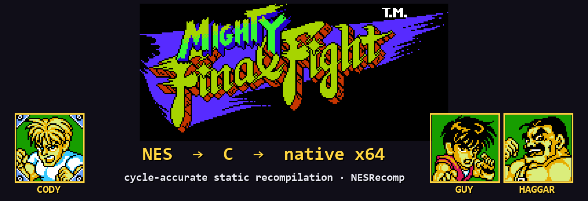
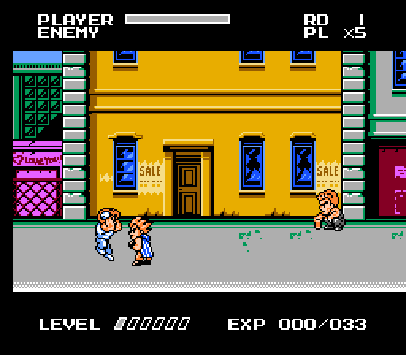
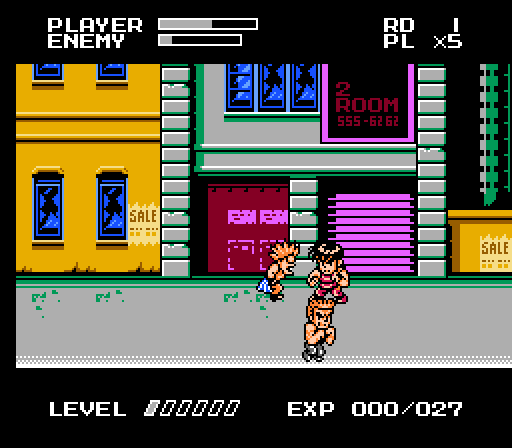
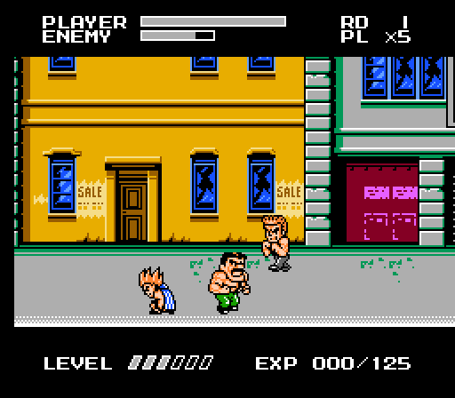
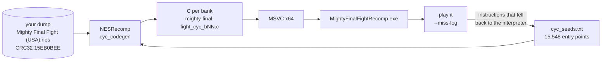
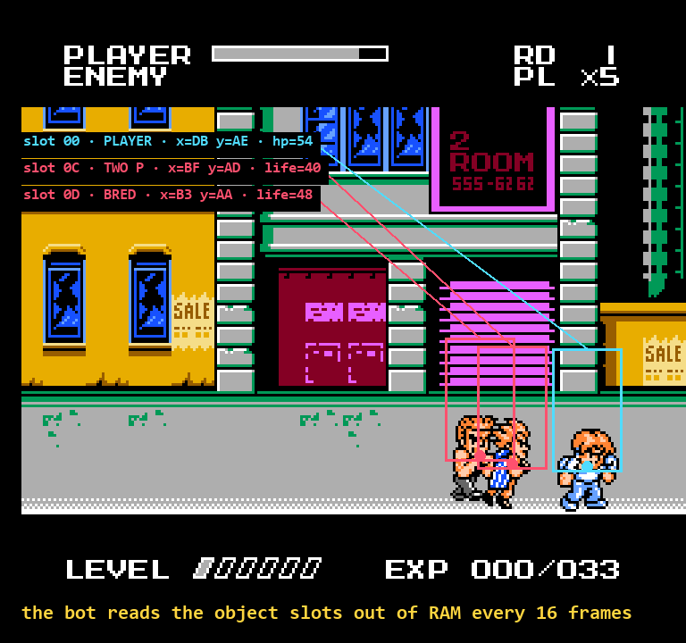
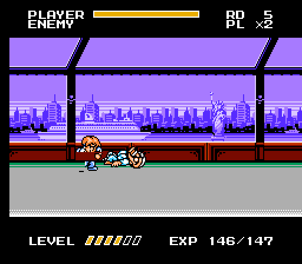
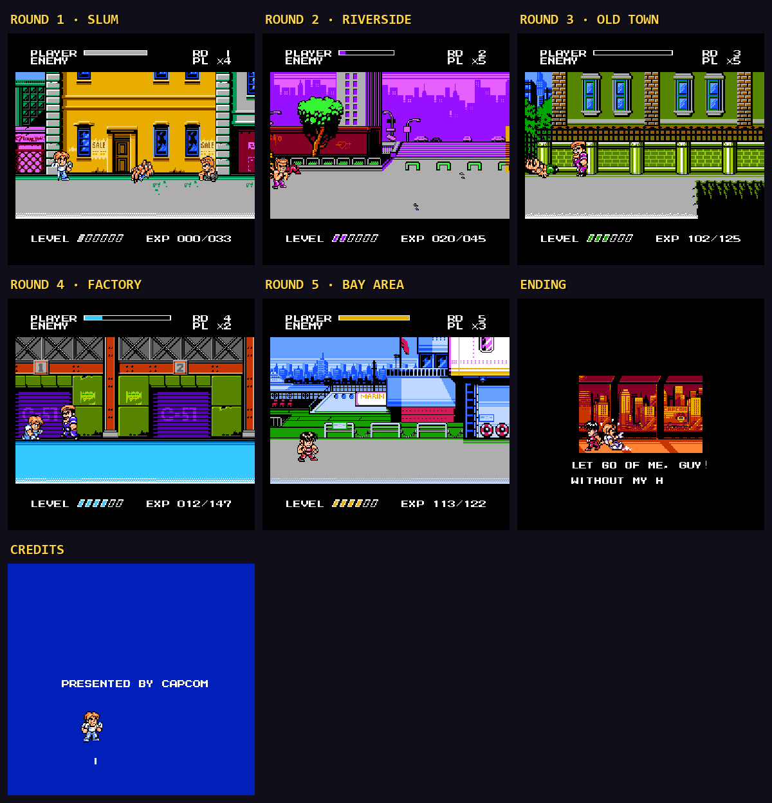
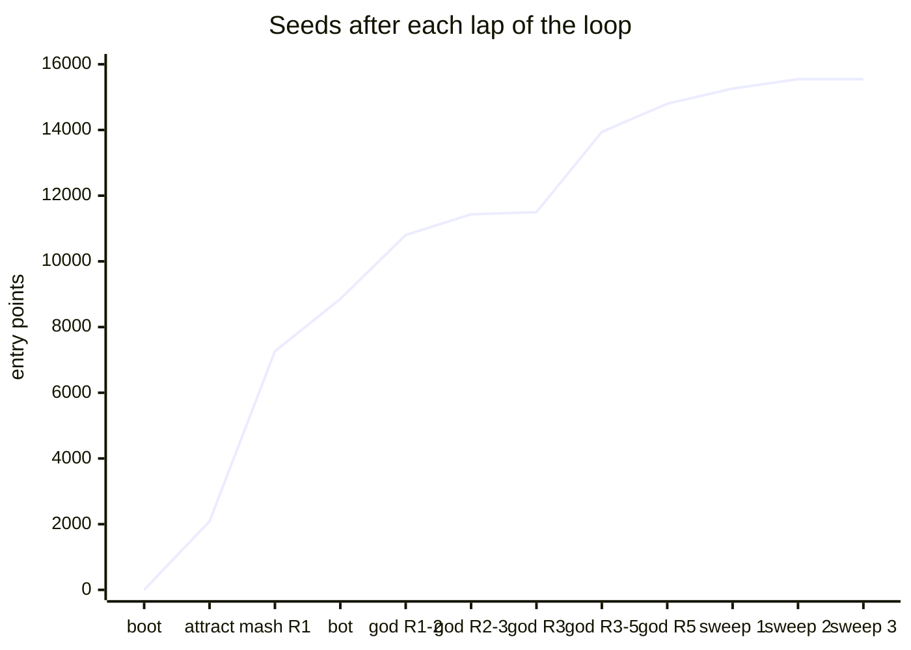
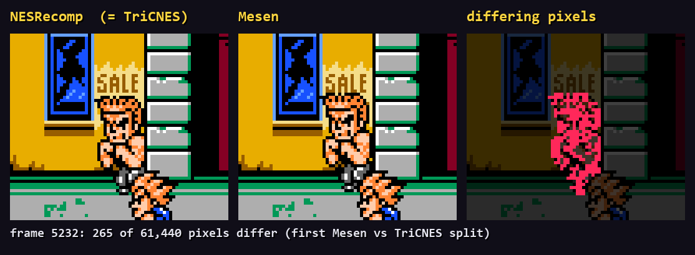

<div align="center">



# Mighty Final Fight Recomp

**Capcom's 1993 NES brawler, translated instruction by instruction into C and built as a native Windows executable. No CPU emulation. And now decompiled: every routine of the game as readable C, running on its own small runtime, with no ROM at run time.**


</div>

---

<div align="center">

| Cody | Guy | Haggar |
|:---:|:---:|:---:|
|  |  |  |
| *"A tough street fighter who is skilled with knives."* | *"Descended from ninja, he possesses incredible agility."* | *"The hot-tempered wrestler and mayor of Metro City."* |

<sub>Every frame above comes from the recompiled executable running headless. Nobody is holding the controller; the coverage bot is.</sub>

</div>

## What this is

[NESRecomp](https://github.com/mstan/nesrecomp) is a static recompiler. It reads the cartridge's 6502 code and writes C: one function for every 1 KB of every PRG bank. MSVC then builds that C together with a cycle-accurate model of the console (PPU, APU, MMC3, DMA, all stepped cycle by cycle). What comes out is an `.exe` where the game itself runs as x64 machine code instead of being interpreted.

The catch is the MMC3 mapper. The game swaps 4 KB windows of code in and out constantly, so static analysis only sees what the fixed banks lead to. Everything else (every move, every enemy, every boss, the ending) only shows up when the game actually runs. Most of this repo is about making all of it run at least once.

```text
boot → intro → title → select → Round 1 … Round 5 → Belger → ending → credits
 100%   100%    100%     100%        100% native           100%     100%     100%
```

## How it works



Whenever an instruction runs on the interpreter, the executable writes down its bank and address (`--miss-log`). That list becomes the seed file, the seeds become compiled code on the next build, and the loop repeats until the list comes back empty.

## The decompiled port (`port/`)

The recompilation above is exact, but it is machine-translated 6502 running on a cycle-by-cycle model of the console. The port is the next step ([PLAN_DECOMP.md](PLAN_DECOMP.md), Portuguese): the game's logic as **readable, named C**, built against a small runtime written for this one game, with the recompiled build kept as the **oracle** every step is checked against.

```text
dump ─► CDL map ─► disassembly ─► scaffold (1 C function per routine) ─► lifted C ─► tidied C ─► own runtime
 P0       P0          P1 (ca65, byte-exact)        P3 (lockstep)            P4          P4         P5 · P6 · P8 · P9
```

| | |
|---|---|
| Game code | **1,168 routines** in 74 C files and 14 headers (about 55,000 lines) in [`port/src/game`](port/src/game), by system: player, player states, enemies and their AI, bosses (Thrasher, Sodom, Abigail, Belger), objects, props, stage, flow and screens, the Capcom sound driver |
| Names | [`disasm/labels.toml`](disasm/labels.toml): 864 labels with evidence; the generated disassembly reassembles byte for byte |
| Runtime | [`port/src/runtime`](port/src/runtime), about 6,000 lines: RAM, the PPU registers and a once-a-frame renderer, the MMC3, the cycle clock, coroutines for the game's four tasks, and a 2A03 synthesizer for the sound. No 6502 CPU, no interpreter, nothing from nesrecomp |
| At run time | no ROM: on the first run the executable extracts the graphics and data tables from **your** dump once (`assets/`); the code in the binary is all C |
| Platforms | Windows (MSVC) and Linux (gcc, clang) checked; macOS written for, not built yet |
| Docs | [objects](docs/objects.md) · [engine](docs/engine.md) · [RAM map](docs/ram_map.md) · [sound](docs/sound.md) · [assets](docs/assets.md) · [port/README.md](port/README.md) |

**How it stays exact.** Every routine had to leave RAM, registers, flags and the cycle count exactly as the original did. Nine test routes (round 1 with each fighter, three 50,000-frame tours through every round, the final boss and the ending, and three 60,000-frame games) compare every frame's RAM, OAM, palette and picture, plus the cycle count, with the unrefactored scaffold. The runs fail if a single ROM instruction is ever interpreted. Paths no route reaches (bonus stage, Belger's death, high-level power moves) were checked by running the old and new code of each routine on millions of random machine states. Against the cycle-accurate oracle, the port's picture is pixel-identical on every power-on route up to the oracle's first lag frame. Its sound makes the same APU writes in the same order, a median of about 7 cycles apart.

**Playing the port.**

```bash
cmake -S port -B build -DMFF_SDL=ON              # add -A x64 on Windows; Linux/macOS use the system's SDL2
cmake --build build --config Release
build/Release/MightyFinalFight.exe "Mighty Final Fight (USA).nes"   # once; later just run it
```

| Option | |
|---|---|
| `--no-flicker` | every sprite every frame, in a stable order (the console's 8-per-line limit made them blink) |
| `--wide [W]` | 16:9 (426 columns): the stage drawn from its own map beyond the original 256 pixels; enemies still enter at the original edge |
| `--picture console\|hd` | the PPU's picture, or one drawn from the game's state |
| F5 / F7 / F6 | save state / load / next slot (4 slots) |
| `MightyFinalFight.ini` | keys, controller, scale, full screen, sound, and the options above |

Keys: arrows · `X` A (jump) · `Z` B (punch) · `Enter` Start · `Right Shift` Select · `Tab` fast · `F11` full screen · `Esc` quit. A+B is the special. `tools/make_port_release.ps1` builds a player zip (executable, SDL2, readme) and checks that it holds nothing from the cartridge.

**Not done yet:** slowdown is not faithful yet. The port never lags where the console does; P7 is on it, with an option to turn slowdown off. Save states work during gameplay, not on screens and cutscenes. In `--wide`, the status bar and the menus are still the original 256 columns, centred. macOS has never been built.

## The bot that played it to the end (with all three)

Hand-writing a frame-by-frame input script for a beat 'em up sounded miserable, so the coverage loop got a player instead: [`tools/bot.py`](tools/bot.py).

<div align="center">

</div>

- Every 16 frames it loads a save state, reads the object table out of RAM (`$0300` state, `$0320` id, `$0360` x, `$03C0` y, `$04A0` life), picks the closest enemy, lines up on the Y axis and starts swinging: punch strings, jump kicks, grabs, the special.
- The game is deterministic, and a loaded state carries on exactly like an uninterrupted run. So the segments glue together into a plain `--input` file that replays the whole session byte for byte (see [`inputs/`](inputs)).
- It notices when it's stuck, wanders off in a random direction and ignores that target for a while.
- `--god` is for coverage only. It tops up health and lives, cuts the life of any boss still standing after 3,000 frames, and after 6,000 frames without progress writes `$0030 = $0E`, the game's own "skip stage" action (listed in the RAM map, confirmed here). The code that runs is always the game's.

<div align="center">

| What tripped the bot up | Fix |
|---|---|
| Chasing an "enemy" at the top of the screen | id `$94` at y = 0 is a spawn marker, not a fighter, so targets must stand on the ground band |
| Thrasher and Sodom never dying | enemy life lives at `$04A0+slot`, not `$049B` as Data Crystal says |
| Round 3's pits kill on contact | refill lives; the real game over had already been covered |
| The final boss dialog never advancing | dialog boxes wait for a fresh A press |

</div>

<div align="center">

<br><sub>Belger. "Beat" him once and you get <code>FINAL VICTORY</code>, then he comes back shooting.</sub>
</div>

## The whole trip

<div align="center">

</div>

## Hunting down interpreted cycles



| Point in time | Native cycles |
|---|---|
| Static discovery only (600 frames) | 91.5% |
| Attract mode, before the first rebuild | 87.1% |
| Attract mode, after it | **100%** (minus the 7 reset cycles) |
| Round 1 gameplay, before seeding | ~82% |
| Rounds 1-5 gameplay, after | **100%** |
| Final sweep: fresh bot seed, from every round start, all three fighters | **0 new seeds** |

Two instructions stay on the interpreter by design: `4k:19:9FFF` and `4k:1D:DFFF` start on the last byte of an 8 KB bank, so the rest of each one comes from whichever bank happens to be mapped next.

## Who's right? Three reference emulators

| Comparison | Result |
|---|---|
| Recompiled vs `--interp-only` (same hardware model, no compiled code) | identical per-frame hashes |
| Recompiled vs **TriCNES** (`cyc_oracle`, the engine's oracle) | bus trace, memory and picture, registers and cycle count **identical for all 5,600 frames** of the Cody route |
| Recompiled vs **Mesen** (MesenCE, `mesen_shot`) | pixel-identical through frame **5231** |

<div align="center">

</div>

At frame 5232 Mesen draws that thug one step behind, and from there the game's RNG goes its own way. NESRecomp still matches TriCNES bit for bit, so this is the two reference emulators disagreeing, not the recompiler getting it wrong. The engine's README lists similar cases in other games (SMB3's status bar IRQ, for one). Tracking down which emulator is right is left as homework.

## Building

> **Bring your own dump:** `Mighty Final Fight (USA).nes`, CRC32 `15EB0BEE` (with header), mapper 4, 128 KiB PRG, 128 KiB CHR.

**Requirements (Windows x64):** Visual Studio 2022 with *Desktop development with C++* (Build Tools is enough), CMake 3.20+ installed to `C:\Program Files\CMake`, Git, and Python 3.11+ (`py`).

```powershell
git clone --recursive https://github.com/Rhayron/MightyFinalFightRecomp.git
cd MightyFinalFightRecomp
.\setup.bat                          # submodules + nestopia-core junction
mkdir rom; copy "<your dump>.nes" rom\
.\build_all.bat                      # build_release\Release\MightyFinalFightRecomp.exe
```

| Command | What it does |
|---|---|
| `build_all.bat` | windowed build with audio and the [recomp-ui](https://github.com/RetroPortingToolKit/recomp-ui) launcher |
| `build_all.bat -Headless` | no SDL, for coverage runs and tests |
| `tools\make_release.ps1` | ZIP in `release\`, no ROM and no player data |

**Controls:** arrows · `Z` A (jump) · `X` B (punch) · `Enter` Start · `Esc` menu · `Tab` fast-forward · `F8`/`F9` save/load state · `F11` fullscreen. Xbox and DualSense pads work through SDL, and everything can be rebound in the launcher. Optional: `--extra-scanlines 128` gives the MMC3 some extra CPU time and cuts down the slowdown.

## Tools

| File | Purpose |
|---|---|
| [`tools/bot.py`](tools/bot.py) | closed-loop player; replayable routes, or coverage with `--god` |
| [`tools/state_ram.py`](tools/state_ram.py) | read and patch RAM inside a `.cycstate` (`get` / `set` / `verify`) |
| [`tools/merge_seeds.py`](tools/merge_seeds.py) | fold miss logs from parallel runs into `cyc_seeds.txt` |
| [`tools/gen_route.py`](tools/gen_route.py) | deterministic button-mash routes per character |
| [`tools/contact_sheet.py`](tools/contact_sheet.py) | turn `--shot-every` output into a timeline |
| [`tools/readme_assets.py`](tools/readme_assets.py) | rebuild every image in this README from your own dump |
| [`docs/ram_map.md`](docs/ram_map.md) | Data Crystal's RAM map, corrected and checked against the running game |

## Numbers

| | |
|---|---|
| Compiled entry points | **15,548** across 20 of the 32 4 KB banks |
| Frames played by the bots | **1.64 million** (about 7.6 hours of game time) over 25 sessions |
| Uncapped speed (window + audio) | ~157 fps, 2.6x real time |
| Incremental headless build | ~25 s |
| Release ZIP | 4.5 MB, no ROM |

## Credits

- **[NESRecomp](https://github.com/mstan/nesrecomp)** by mstan: the recompiler, the cycle-accurate runner and the TriCNES oracle. The submodule is `2b4fcdb` plus five commits for this project (a CDL logger, an NMI hold hook for the scaffold, `replace_func` fixes), on branch `mff-scaffold` of [Rhayron/nesrecomp](https://github.com/Rhayron/nesrecomp).
- **[recomp-ui](https://github.com/RetroPortingToolKit/recomp-ui)**: launcher and in-game menu (Dear ImGui).
- **[MesenCE](https://github.com/nesdev-org/MesenCE)**: the third pair of eyes.
- **[Data Crystal](https://datacrystal.tcrf.net/wiki/Mighty_Final_Fight/RAM_map)**: where the RAM map started.
- Project template: [YoshisCookieRecomp](https://github.com/mstan/YoshisCookieRecomp).

## Legal

This repository contains **no ROM**, no extracted graphics or data, and no generated disassembly or recompiled code. The builds produce those locally from **your** dump. The C in `port/src/game` is a hand-made decompilation: it is a derivative work of Capcom's program code, published the way decompilation projects such as the *Super Mario 64* and *A Link to the Past* ones publish theirs. Neither the source nor the port's executable contains the cartridge's data; they need your dump to run. *Mighty Final Fight* is © Capcom. This is a preservation and research project with no affiliation with Capcom or Nintendo. The screenshots above were captured from the executable running the author's own dump.

<div align="center"><sub>Working plans (Portuguese): <a href="PLAN_DECOMP.md">PLAN_DECOMP.md</a> (the port) · <a href="PLAN_WINDOWS.md">PLAN_WINDOWS.md</a> · <a href="PLAN.md">PLAN.md</a> (macOS)</sub></div>
